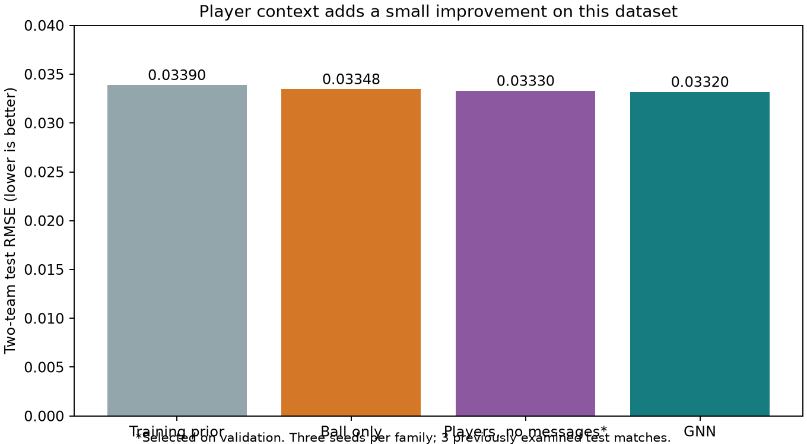
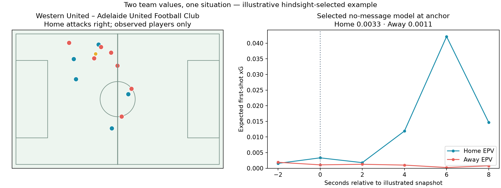
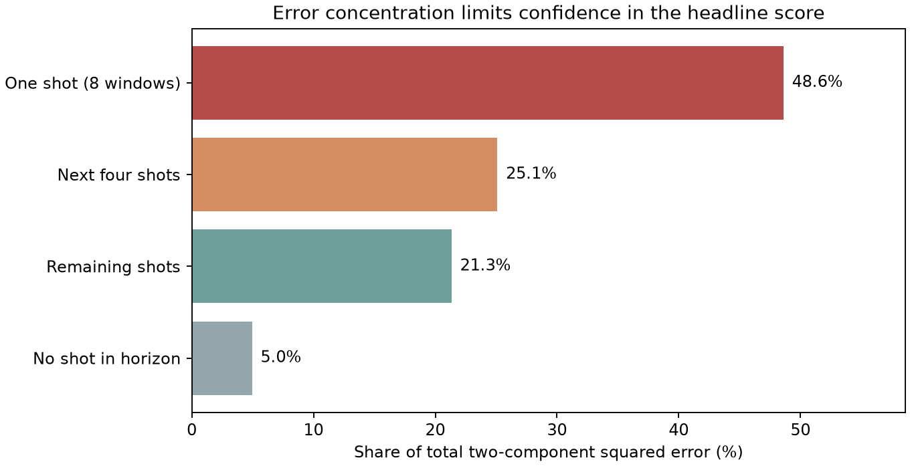

# Open Graph EPV

**Does player context improve short-horizon football value estimates beyond ball information?**

An open-data research project predicting `home_team_epv` and `away_team_epv`
from tracking. The target is the contextual xG of the **first shot in the next
15 seconds**, attributed to its team; no shot gives two zero targets. Both
predicted expectations can be positive. This is a first-shot value proxy,
not a validated probability of scoring at least once.

**Finding:** player context gives a small improvement over the ball-only model.
The evidence is insufficient to claim tactical understanding or superiority to
SkillCorner's own models. The useful outcome is a reproducible experiment with
explicit target definitions, simple controls and a documented failure analysis.

## Results against simple baselines

Lower two-component RMSE is better; average squared error over home and away,
then square root. All models use the same targets and match split.

| Model | Validation RMSE | Test RMSE |
|---|---:|---:|
| Training-mean prior (possession-relative) | — | 0.033899 |
| Ball-only MLP | 0.026231 | 0.033477 |
| Player set model, no messages **(validation winner)** | **0.025301** | 0.033305 |
| Message-passing GNN | 0.025388 | 0.033200 |

The selected set model improves test RMSE by **1.75% over the prior** and
**0.51% over ball-only**. The GNN's corresponding improvements are 2.06% and
0.83%, but it did not win validation. Each family averages three seeds.
The three test matches have been examined during development: these are
exploratory results, not an untouched final evaluation.



## Data and method

- **SkillCorner Open Data:** 20 Australian A-League 2024/25 matches, 10 Hz
  tracking and 526 shot markers. [Source and pinned revision](https://github.com/SkillCorner/opendata/tree/4340d274572876239c154c90bc507a9b3250a656),
  [MIT license](third_party/SkillCorner-LICENSE.txt).
- **StatsBomb Open Data:** 644 matches, 16,509 shots in the original corpus.
  A separate logistic xG model is trained on goal/non-goal outcomes using
  geometry, goalkeeper and defender features. These are **our estimates, not
  StatsBomb's supplied xG values**. [Source and pinned revision](https://github.com/hudl/open-data/tree/4b73468fc5b0f1950f9f66fada70ad3a4f9327cb),
  [separate public-data agreement](third_party/StatsBomb-LICENSE.pdf).
- Transfer produces **413 contextual estimates and 113 geometry fallbacks**.
  Missing context is not relabelled as “no shot”. Contextual xG improves
  StatsBomb held-out log loss from 0.275918 to 0.258118 on the same 2,432
  eligible test shots; this does not establish calibration on SkillCorner.
- Each graph contains the ball and observed players, with position, backward
  velocity, team and role features. A two-layer GNN is compared with a
  no-message player model and ball-only MLP. MSE fits conditional means.
- **14 / 3 / 3 matches** yield **20,862 / 4,284 / 4,228** training, validation
  and test snapshots. Match splitting keeps overlapping windows together.

[Method and target semantics](docs/methods.md) ·
[Detailed two-team experiment](reports/team_epv.md) ·
[Machine-readable results](reports/portfolio_results.json)

## See and run the project

Open [demo/index.html](demo/index.html) locally in your browser: six recorded
sequences, separate home/away values, and model comparisons. No server, weights
or data downloads are required. GitHub itself displays HTML source; download
or clone the repository to open the demo.



The [walkthrough notebook](notebooks/01_public_pipeline.ipynb) reconstructs a
graph and target from a small public training example, demonstrates one-example
fitting, and reads the frozen full-experiment results. Its fitting exercise is
not a reproduction of the benchmark. No trained weights are distributed.

From this directory, using Python 3.12:

```bash
python -m venv .venv
source .venv/bin/activate
python -m pip install -r requirements.txt
python examples/run_walkthrough.py
python -m pytest -q
```

The notebook also runs as ordinary Python through the supplied runner; Jupyter
is optional. For an interactive notebook, install `jupyterlab` separately and
open `notebooks/01_public_pipeline.ipynb`.
[Full download, training and inference instructions](docs/reproduce.md) need
several GB of disk space. [Code explanation guide](docs/explain_the_code.md).

## Limitations and what I would test next

**One future shot accounts for 48.6% of the GNN's test squared error**, through
eight overlapping windows. Its transferred xG is 0.764 versus 0.144 from the
geometry teacher. That discrepancy deserves review; neither value is ground
truth. The test contains only 79 distinct future shots.



- Many windows have no shot. A small aggregate RMSE does not demonstrate
  reliable ranking of dangerous situations.
- Tracking visibility and event alignment affect both input and teacher quality.
  Goal calibration, shot completeness and penalty coverage on SkillCorner remain
  unverified. The target mixes contextual and geometry estimates.
- Future xG is a model-generated label. Predicting it accurately does not prove
  accurate goal probabilities; first-shot value also omits rebounds and later shots.
- Test reuse, only three test matches and overlapping windows limit inference.
  Small model differences do not establish a robust architecture advantage.
- This is supervised prediction, not reinforcement learning or a causal tool for
  recommending player movements. The figures show hindsight-selected examples.

Next: audit high-value shot labels and missing context, then evaluate on genuinely
new matches. More architectures are a lower priority than reliable targets and
independent evaluation.

## Attribution and development

Tracking and events: **SkillCorner / PySport open-data initiative**. xG training:
**StatsBomb Open Data**. The MIT [code license](LICENSE) does not relicense the
StatsBomb data or remove its noncommercial-use and attribution terms.


Developed with AI assistance. The runnable example and
[explanation guide](docs/explain_the_code.md) make the choices reviewable;
passing tests does not certify the author's understanding or the model's utility.

This standalone publication package excludes the parent project's Barça/private
data, derived artifacts and weights. Its small demonstration extracts come from
pinned public SkillCorner files; [provenance](reports/public_provenance.json)
records input and asset hashes. [Publication checks](docs/publication.md).
