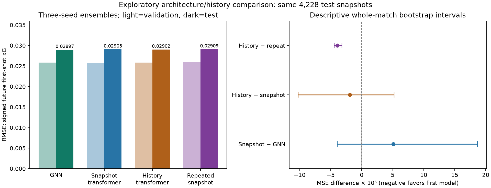
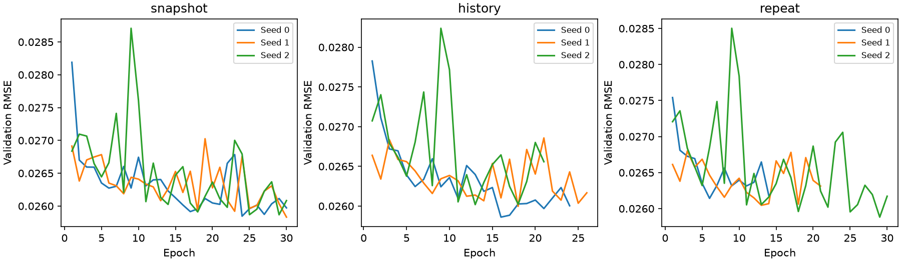

# GNN, graph transformer og historikk

Eksperiment gjennomført 5. november 2026. **Modell valgt på valideringsdata: Transformer: nåbilde.** Dette er en utforskende sammenligning på de tidligere brukte testkampene; ingen ny, uavhengig sluttest er opprettet.

## Hva som er sammenlignet

1. Den eksisterende message-passing-GNN-en på ett øyeblikksbilde.
2. En liten graph transformer på samme øyeblikksbilde.
3. Den samme transformeren med spillerhistorikk ved −2, −1, −0,5 og 0 sekunder.
4. En kontroll der nåbildets verdier gjentas på historikktidspunktene, med samme historiske synlighetsmaske for dagens synlige spillere.

Ballmodellen og spillermodellen uten meldinger er beholdt som referanser. De opprinnelige GNN-, ball- og set-modellene er uendret; ni nye transformer-modeller er trent, tre tilfeldige frø per betingelse.

Alle bruker samme StatsBomb-trente geometriske xG-lærer, samme 526 skuddmarkører, samme signerte første-skudd-xG innen 15 sekunder og samme kampsplitt. Datasettet inneholder 20 862 treningsbilder fra 14 kamper, 4 284 valideringsbilder fra tre kamper og 4 228 testbilder fra tre kamper. Null betyr ingen skudd innen horisonten. Et skudd akkurat på nåtidspunktet er utelatt fra fremtidsvinduet; periodens slutt sensurerer ufullstendige horisonter.

## Kapasitet og arkitektur

GNN-en har **31,537 parametere**. Hver transformer har **31,961**, bare 1.34 % flere. Transformeren har to romlige attention-lag, fire hoder og 40 skjulte dimensjoner. Den bruker samme nodefeatures, fire relasjonsfeatures, separate gjennomsnitt for lag og ball, samt tanh-utgang som GNN-en. GNN-en har 48 skjulte dimensjoner og aggregerer lærte meldinger med gjennomsnitt.

Attention beregner vekter fra query/key-likhet og en lært bias fra relativ posisjon, avstand og lagtilhørighet. Romlig attention inkluderer egen node. Trajektorie-encoderen bruker nåtidens node som query over samme spillers tidligere representasjoner. Q/K/V- og utgangsprojeksjonene deles med første romlige blokk for å holde parameterbudsjettet fast. Deretter beregnes samspillet mellom spillerne ved nåtidspunktet. Dette er en liten, egen forsøksmodell, ikke hovedprosjektets større GraphTemporalTransformer.

Alle tre transformerbetingelsene har identisk arkitektur og parameterantall. Nåbildevarianten bruker ett tidssteg; tidsencoderen får da null og gir ingen historisk informasjon. Historikkmodellen er ikke en full modell av alle tidligere samspill mellom spillere: den oppsummerer hver spillers egen bane før den romlige modelleringen. Attention-vekter er ikke kausale forklaringer.

## Kontroll mot lekkasje og feil spillerkobling

Historikken er hentet fra eksakte tidligere frames. Vi bruker nåtidens spiller-ID-er og retning relativt til laget som har ballen nå. En annen spillerrekkefølge eller et tidligere bytte av ballbesittelse skal derfor ikke flytte historikken til feil spiller eller snu banen. Tidligere spillere som ikke lenger finnes i nåbildets spillerliste, tas ikke inn som nye noder. Manglende historikk maskeres; vi henter aldri frames fra en annen periode. Hastigheter bruker bare det umiddelbart foregående råbildet.

Nåbildet i hver av de 29 374 historikkradene er kontrollert **bit-for-bit identisk** med det opprinnelige datasettet, inkludert synlighetsmasken. Målvariabelen og radrekkefølgen er uendret. Historiske bilder uten observerbar ball eller tilstrekkelig grafkontekst maskeres konservativt. Den ekstra komprimerte historikkfilen er rundt 19 MB; rådataene er gjenbrukt.

Gjenta-nåbildet-kontrollen beholder tidligere synlighet for spillerne som er synlige nå. Dermed sammenligner historikk mot kontroll primært verdiene i tidligere posisjoner/hastigheter, betinget på samme dekning. Historikk kontra ett nåbilde kan også påvirkes av synlighetsinformasjon og beregningsstruktur.

## Trening og modellvalg

Alle nye kjøringer bruker MSE, AdamW med læringsrate 0,001 og weight decay 0,001, batchstørrelse 64, gradientklipping 1,0 og maksimalt 30 epoker. Tidlig stopp har tålmodighet på åtte epoker. Dette følger den eksisterende GNN-oppskriften; hver arkitektur er ikke separat finjustert til sitt beste mulige oppsett. Det velges checkpoint utelukkende på validerings-MSE.

Speiling under trening bruker samme fortegn for hele historikken til et bilde. Inferens tar speilsnitt og deretter likt gjennomsnitt av frø 0, 1 og 2. Kandidaten blant GNN, nåbilde-transformer og historikk-transformer velges på valideringsfeilen til ensemblet. Gjenta-kontrollen er bare en diagnose. Protokoll, kode, datasett og modellfiler kontrolleres med SHA256; modellvalget lagres før samlet testevaluering. En separat rådata-inferenskontroll under trening beregnet én prediksjon uten å bruke målverdien eller gjøre modelltilpasning.

## Resultater

Lavere RMSE er bedre. Alle radene gjelder de samme situasjonene.

| Modell | Validering RMSE | Test RMSE |
|---|---:|---:|
| GNN | 0.025809 | 0.028966 |
| Transformer: nåbilde | 0.025780 | 0.029054 |
| Transformer: historikk | 0.025858 | 0.029021 |
| Transformer: gjentatt nåbilde | 0.025926 | 0.029089 |
| Bare ball | 0.026712 | 0.029360 |
| Spillere uten meldinger | 0.026010 | 0.029002 |

Nåbilde-transformeren vant den forhåndsbestemte valideringsseleksjonen. På test hadde GNN lavest feil av disse arkitekturene: nåbilde-transformerens RMSE er 0.30 % høyere. Historikk reduserer RMSE med 0.11 % mot ett nåbilde og 0.23 % mot gjenta-kontrollen. Den er fortsatt litt svakere enn GNN samlet.

Historikk slår gjenta-kontrollen på alle tre kampene, og det beskrivende bootstrap-intervallet for akkurat denne kontrasten ligger under null. Dette er et lite positivt signal for ekte trajektorieinformasjon i denne arkitekturen. Kontrastene nåbilde-transformer mot GNN og historikk mot ett nåbilde har intervaller som krysser null. Vi kan derfor ikke hevde en tydelig generell gevinst ved å bytte fra GNN til transformer eller ved å legge til historikk. Modellvalget i de lagrede artifaktene forblir valideringsvalget; ingen ny tuning er gjort etter testresultatene.



Testmålene og utvalget er det opprinnelige snapshot-utvalget. Tallene skal ikke direkte sammenlignes med RMSE fra SkillCorner-rapportens 1 850 hendelsesstarter: den rapporten bruker et annet utvalg av situasjoner.

Planlagte kontraster er MSE for første modell minus MSE for andre. Negativt tall favoriserer første modell. Intervallene er beskrivende hel-kamp-bootstrap med alle 27 ordnede trekk fra tre kamper.

| Kontrast | MSE-forskjell | Beskrivende 95 % intervall |
|---|---:|---:|
| snapshot_minus_gnn | +5.119e-06 | [-3.925e-06, +1.866e-05] |
| history_minus_snapshot | -1.891e-06 | [-1.024e-05, +5.230e-06] |
| history_minus_repeat | -3.923e-06 | [-4.424e-06, -3.175e-06] |
| repeat_minus_snapshot | +2.032e-06 | [-6.129e-06, +9.654e-06] |

Tre kamper er for lite til sterke generaliseringspåstander. Overlappende snapshots er ikke uavhengige observasjoner. Intervallene inkluderer ikke usikkerhet fra ny modelltrening eller overføring av xG-læreren. Testkampene er allerede undersøkt i tidligere eksperimenter, så intervaller som eventuelt ikke krysser null er fortsatt utforskende funn.

| Betingelse | Frø | Valgt epoke | Kjørte epoker | Test RMSE |
|---|---:|---:|---:|---:|
| snapshot | 0 | 24 | 30 | 0.029225 |
| snapshot | 1 | 30 | 30 | 0.029025 |
| snapshot | 2 | 29 | 30 | 0.029076 |
| history | 0 | 16 | 24 | 0.029134 |
| history | 1 | 18 | 26 | 0.029143 |
| history | 2 | 13 | 21 | 0.029074 |
| repeat | 0 | 6 | 14 | 0.029265 |
| repeat | 1 | 13 | 21 | 0.029195 |
| repeat | 2 | 29 | 30 | 0.029072 |



## Reproduser

Fra `projects/open-graph-epv`, med pakken installert eller `PYTHONPATH=src`:

```sh
python -c "from open_graph_epv.history_data import prepare; prepare('data/skillcorner', 'outputs/graphs_v1', 'outputs/history_v1')"
python examples/run_attention_history.py --workers 2
python examples/report_attention_history.py
python examples/score_attention.py --mode history --match 2015213 --frame 2240
```

Kommandoene forutsetter at xG-/GNN-artifaktene fra hoved-README er laget. Eksisterende utdata overskrives ikke. Protokollen ligger i `configs/attention_history_v1.json`. Når et nytt datasett eller kode endres, må en ny protokoll registreres og nye utdatamapper brukes.

Ferdige kjøringer kan inspiseres i `outputs/attention_history_v1/<betingelse>_seed<frø>/training.json`. En kontrollert ny kjøring kan startes med `python -m open_graph_epv.attention_experiment train --mode snapshot --seed 0 --out outputs/ny_kjoring`. Modellvalget ligger i `selection.json`, testresultatene i `audit/report.json`, og per-situasjonsprediksjonene i `audit/predictions.npz`. Numerisk rapport for deling: [attention_history_v1.json](attention_history_v1.json). Figuren finnes også som [PDF](figures/attention_history.pdf).

De 36 offline-testene dekker blant annet spillerpermutasjon, speilsymmetri, maskerte verdier, endelige gradienter, likt parameterbudsjett, kontrollenes uavhengighet av tidligere posisjoner, spiller-ID-kobling, besittelsesretning, perioder og fremtidsgrenser. Ingen rådata eller modeller er publisert eksternt av denne kjøringen.
