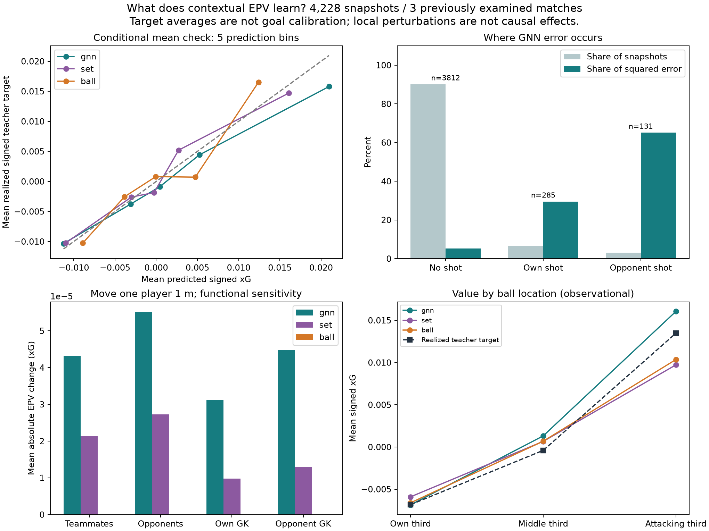
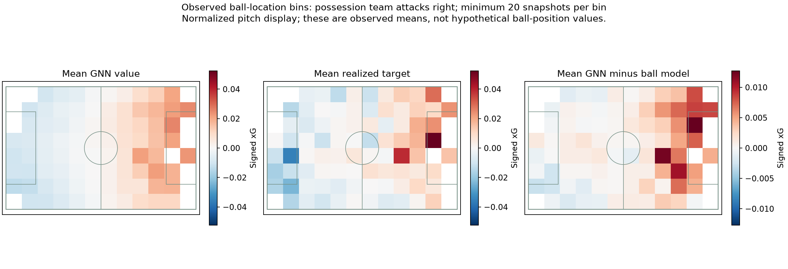

# Hva lærer modellen? Diagnostikk og visualiseringer

Denne analysen gjelder den tidligere modellen med én signert nettoverdi. Se [den nye to-lagsmodellen](team_epv.md) for separate `home_team_epv` og `away_team_epv` og den oppdaterte sekvensviseren.

Undersøkt 10. november 2026. Analysen bruker de frosne kontekstuelle EPV-modellene og 4 228 snapshots fra tre tidligere undersøkte testkamper. Ingen vekter eller modellvalg er endret. Dette er utforskende modellkontroll.

## Funn

**Modellen skiller mellom områder på banen.** GNN-ens gjennomsnittlige verdi er −0,00686 i egen tredel, +0,00131 i midtre tredel og +0,01605 i angrepstredelen. Laget med ballen definerer fortegnet. De tilsvarende gjennomsnittlige realiserte targetverdiene er −0,00683, −0,00040 og +0,01347. Dette er observerte sammenhenger mellom ulike situasjoner, ikke effekten av å flytte ballen.

**Spillerkontekst påvirker beregningen, men mer følsomhet betyr ikke bedre prediksjoner.** Når én observert motspiller flyttes én meter, er gjennomsnittlig absolutt GNN-endring omtrent 0,000055 xG, mot 0,000027 for modellen uten meldinger. Flytt av medspillere gir henholdsvis 0,000043 og 0,000021. Ballmodellen er uendret innen numerisk avrunding. Dette viser at GNN bruker spillerposisjonene; det validerer verken spillerbidrag eller bevegelsesforslag.

**Bevegelsesinformasjon påvirker også verdien.** Å sette alle spillerhastigheter og deres gyldighetsflagg til null endrer GNN-verdien med gjennomsnittlig 0,00484 i absoluttverdi. Dette fjerner mye mer informasjon enn en enkelt posisjonsendring, og størrelsene kan ikke sammenlignes som et mål på relativ viktighet. Den kunstige scenen kan ligge utenfor treningsfordelingen.

**Feilen er svært konsentrert.** 90,2 % av vinduene har ikke skudd i horisonten og står for 5,3 % av samlet kvadrert GNN-feil. De øvrige vinduene peker mot 79 forskjellige skudd. Åtte overlappende vinduer foran ett skudd står alene for **48,2 % av den kvadrerte feilen**: kamp 2015213, skuddframe 69607, kontekstuell xG 0,7637. Denne verdien er et modellestimat, ikke en verifisert sannsynlighet. Skuddet er beholdt i evalueringen. Neste målrettede datakontroll bør undersøke dette skuddets timing og lærerens kontekstgrunnlag; stor feil alene er ingen grunn til å fjerne det.

**Keeperobservasjonene er få i følsomhetsutvalget.** Analysen bruker 96 jevnt fordelte test-snapshots, valgt uten target eller prediksjon. Egen keeper har gyldige posisjonsendringer i 14, motstanderkeeperen i 19. Dermed bør keeperresultatene tolkes langt mer forsiktig enn resultatene for utespillere. Kontekstuell xG ved det framtidige skuddet betyr ikke at keeperen er synlig i alle tidligere EPV-snapshots.



## Interaktiv sekvensviser

Den lokale viseren ligger i `outputs/contextual_diagnostics_v2/explorer.html`. Åpne filen i nettleseren; server og eksterne biblioteker er ikke nødvendig. Den inneholder:

- Seks tydelig merkede eksempler: store framtidige skuddverdier for/mot, høy prediksjon uten skudd, modelluenighet og feil nær medianen.
- Baneposisjoner, spillernumre, keepermarkering og valgfrie hastighetsvektorer.
- Modellbytte mellom GNN, spillere uten meldinger og ballmodellen.
- Avspilling, tidsskyver og klikkbar tidslinje for prediksjoner og realisert framtidig target.
- Lokal følsomhet når én spiller flyttes én meter; dette er ikke en anbefalt bevegelse.

Hjemmelagets perspektiv er fast i hele klippet. Banen og verdienes lagperspektiv snur derfor ikke ved besittelsesbytte. Targeten er etterpåinformasjon og kan skjules for lettere å sammenligne modellkurvene. Hull bryter kurvene; bare faktiske observerte snapshots vises. Eksemplene er valgt med etterpåinformasjon og dokumenterer ikke representativ ytelse.

Den samme output-mappen inneholder `diagnostics.pdf` med tre figursider, tre PNG-figurer, `report.md`, `report.json` og en nettleserkontroll. Sekvensdata og figurer med spillerposisjoner holdes i den lokale output-mappen. De aggregerte resultatene og figurene i denne rapporten kan inngå i prosjektets dokumentasjon, med samme attribusjon og datavilkår som ellers.



## Reproduser

Fra prosjektmappen, med den ferdigtrente kontekstuelle EPV-versjonen og `.[plots]` installert:

```bash
python examples/visualize_contextual_epv.py --out outputs/contextual_diagnostics_next
```

Velg en ny utdatamappe. Programmet kontrollerer sjekksummer for datasettene, modellvalget, prediksjonene og rå tracking. Et deterministisk utvalg predikeres på nytt og sammenlignes med den frosne evalueringen. Alle viste baneposisjoner kontrolleres mot de forberedte grafene.

**Verifisert:** 57 offline-tester passerer. Nettleserkontrollen dekker 54 kombinasjoner av sekvens, modell og tidspunkt, avspilling og visningskontroller. Ingen JavaScript-feil eller horisontal overflyt på mobil ble funnet. Desktop- og mobilvisning er kontrollert.

En betinget forventning behøver ikke treffe den realiserte skuddverdien i ett bestemt vindu. Disse analysene dokumenterer at modellen bruker informasjon og hvor feil oppstår; de etablerer ikke målkalibrering, taktisk forståelse eller kausale handlingseffekter. Se [tall og proveniens](contextual_diagnostics_v1.json) og [EPV-evalueringen](contextual_epv.md). StatsBomb- og SkillCorner-attribusjon og datavilkår i hoved-README gjelder fortsatt.
