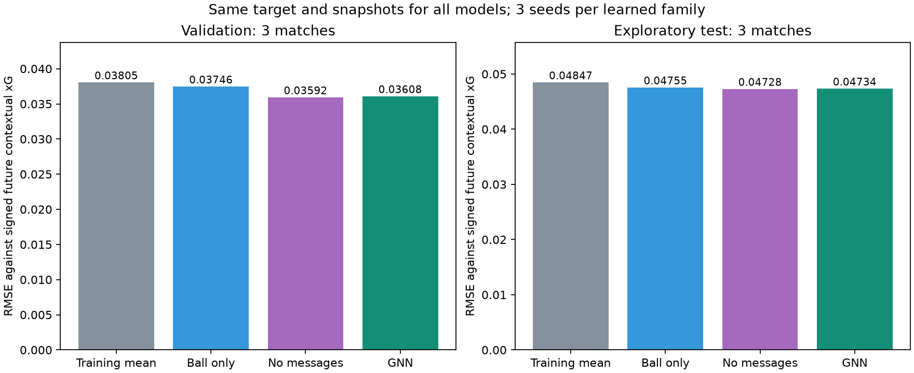

# EPV med kontekstuell xG som målvariabel

Hovedprosjektet bruker nå [to separate lagverdier](team_epv.md): `home_team_epv` og `away_team_epv`. Rapporten nedenfor gjelder den tidligere nettomodellen.

Ferdig trent og evaluert 6. november 2026. **Dette dokumenterer den tidligere modellen med én signert nettoverdi.** Ni nye modeller er trent på SkillCorner-tracking med målverdier fra vår StatsBomb-trente kontekstuelle xG-modell. Modellen valgt på valideringsdata er **set**. GNN-en beholdes i inferenspakken uansett valideringsvinner.

## Hva modellen skal lære

For en situasjon s lærer modellen den betingede forventningen E[Y | s]. Y er xG for det første skuddet i de neste 15 sekundene: positivt når laget med ballen nå skyter, negativt når motstanderen skyter, og null hvis det ikke kommer et skudd. Skudd i selve snapshot-øyeblikket er ekskludert; skudd nøyaktig 15 sekunder senere er inkludert. Hele horisonten må ligge innen samme omgang. Klokken løper også under avbrudd, og målverdien er ikke begrenset til samme ballbesittelse.

Skuddets xG beregnes med skuddgeometri, keeperposisjon og forsvarerposisjoner. Den separate læreren er logistisk regresjon med 18 features, trent mot faktiske mål/ikke-mål i StatsBomb. Den er **ikke StatsBombs proprietære xG-modell**. Se [xG-eksperimentet](contextual_xg.md) for features, validering og kildeoverføring.

Fremtidig skuddkontekst brukes bare til å lage treningsmålet. EPV får nåværende tracking og bakoverberegnet hastighet som input, uten fremtidig skuddinformasjon. MSE brukes fordi optimum i forventning er den betingede middelverdien. En robust tapsfunksjon som Smooth L1 har generelt et annet optimum og kan nedvekte sjeldne, verdifulle skudd.

Verdien er **forventet signert første-skudd-xG**, ikke direkte sannsynligheten for minst ett mål. Koblingen til målrisiko avhenger av lærerens kalibrering i relevante situasjoner. Flere skudd, returer, den negative motstanderkomponenten og den valgte horisonten gjør at disse begrepene ikke kan brukes om hverandre.

## Datagrunnlag og dekning

StatsBomb-læreren bruker 11 346 kontekstuelle treningsskudd; 2 536 valideringsskudd velger modell/regularisering, og 2 432 testskudd evaluerer kontekstmodellene på samme utvalg. På disse testskuddene er log loss 0,258118 mot 0,275918 for en geometrikontroll trent på samme utvalg. Dette er evaluering på StatsBomb, ikke validering av målkalibrering i SkillCorner.

SkillCorner bidrar med 20 kamper og 526 skuddmarkører. **413 skudd får kontekstuell xG; 113 bruker den dokumenterte geometriske reservemodellen.** Alle skudd beholdes. Manglende kontekst blir aldri gjort om til null eller til «ingen skudd». Ett ellers tilgjengelig kontekstskudd faller utenfor lærerens treningsintervall og får reserveverdi.

Dette er derfor en hybrid målvariabel med kontekstuell xG som hovedkilde. En modell trent utelukkende på kontekstuelle targets ville kreve at vinduer med ukjent target ble ekskludert og at utvalgsskjevheten ble vurdert separat. Vi velger full skudddekning med eksplisitt provenance.

De 29 374 grafene fordeles på 20 862 trening, 4 284 validering og 4 228 test, fra henholdsvis 14/3/3 hele kamper. Input, maske, kamp, frame og skuddtilstedeværelse er kontrollert identiske med tidligere snapshot-datasett. Det som endres, er skuddverdiene. Totalt har 26 509 vinduer ingen fremtidige skudd, 2 350 har kontekstuell xG og 515 har reserve-xG. Flere vinduer kan vise mot samme skudd og er ikke uavhengige observasjoner.

## Modell og forsøksoppsett

GNN-en har to lag med meldingsutveksling og 31 537 parametere. Grafen inneholder ballen og opptil 22 spillere. Input er posisjon, bakoverberegnet hastighet, lagtilhørighet, keeper-/ballindikatorer og observasjonsmasker. Ekstrapolerte noder maskeres. Nåværende besittelseslag angriper alltid mot +x.

Kontrollene er en ballmodell og samme spillermodell uten meldingsutveksling. Hver familie trenes med tre seeds (0, 1, 2), maksimalt 30 epoker og tidlig stopp etter åtte epoker uten bedre validerings-MSE. Alle bruker samme målvariabel og kampsplitt. Familien velges etter MSE for gjennomsnittet av tre modeller på valideringsdata. Kildekode, data og vekter fryses før testberegningen.

Speiling over banens lengdeakse brukes under trening. Inferens er gjennomsnittet av original og speilet situasjon, slik at sidevalg alene ikke endrer verdien. Denne symmetrien gjelder modellens forenklede input; modellen kjenner ikke spillerens foretrukne fot eller identitet.

## Resultater

| Modell / tre-seed-ensemble | Validerings-RMSE | Test-RMSE |
|---|---:|---:|
| Treningsgjennomsnitt | 0.038045 | 0.048466 |
| Bare ball | 0.037457 | 0.047546 |
| Spillere uten meldinger | 0.035917 | 0.047279 |
| GNN | 0.036080 | 0.047335 |

GNN har 2.33 % lavere test-RMSE enn treningsgjennomsnittet. Valideringsvinneren `set` har 2.45 % lavere test-RMSE enn samme referanse. Sammenligningen med spillermodellen uten meldinger isolerer nytten av meldingsutveksling; den må vurderes sammen med kampintervallene nedenfor.

Dette er en utforskende evaluering på tre kamper som også er undersøkt i tidligere eksperimenter. De er holdt utenfor fitting og modellvalg i denne kjøringen, men er ikke et nytt urørt testsett. **Gamle og nye RMSE-tall kan ikke sammenlignes direkte fordi targetverdiene er endret.**

| Parvis MSE-forskjell | Forskjell | Beskrivende 95 % kampintervall |
|---|---:|---:|
| gnn_vs_mean | -0.00010832 | [-0.00016350, -0.00004350] |
| gnn_vs_ball | -0.00001999 | [-0.00004220, 0.00001073] |
| gnn_vs_set | 0.00000535 | [-0.00001882, 0.00003353] |

Negativ forskjell favoriserer GNN. Intervallene bruker alle 27 ordnede bootstrap-trekk av tre hele kamper. De er beskrivende og inkluderer verken ny trening eller lærerens usikkerhet. Tre kamper gir ikke grunnlag for sterke generaliseringspåstander.

### Diagnostikk etter targetkilde

| Targettype i test | Vinduer | GNN-RMSE | Ball-RMSE | Uten meldinger-RMSE |
|---|---:|---:|---:|---:|
| no future shot | 3812 | 0.011496 | 0.007385 | 0.009857 |
| contextual xG | 345 | 0.151410 | 0.154634 | 0.151976 |
| geometric fallback xG | 71 | 0.122211 | 0.124496 | 0.125147 |

Gruppene bestemmes av hva som skjer senere. De brukes til diagnostikk etter evaluering, ikke til valg av modell ved inferens. Feilnivåene mellom gruppene kan ikke tolkes som et kontrollert estimat av kontekstens effekt: situasjoner og targetfordelinger er forskjellige.

### Enkeltkjøringer

| Familie | Seed | Validerings-RMSE | Test-RMSE |
|---|---:|---:|---:|
| gnn | 0 | 0.035976 | 0.047445 |
| gnn | 1 | 0.036830 | 0.047415 |
| gnn | 2 | 0.036255 | 0.047785 |
| ball | 0 | 0.037465 | 0.047614 |
| ball | 1 | 0.037469 | 0.047541 |
| ball | 2 | 0.037515 | 0.047543 |
| set | 0 | 0.036001 | 0.047722 |
| set | 1 | 0.036420 | 0.047392 |
| set | 2 | 0.035981 | 0.047183 |

## Sammenligning med SkillCorner

Her evalueres **1850 event-start-situasjoner fra 3 testkamper**, med 1891 valideringssituasjoner til tilpasning. Det er et annet utvalg enn snapshot-tabellen over. Alle verdier måles mot den nye kontekstuelle målvariabelen. SkillCorners for-/motverdier tilpasses målvariabelen med en affin modell tilpasset kun valideringskampene; råverdier og en tilsvarende tilpasset GNN rapporteres også.

| Modell / referanse | Test-RMSE |
|---|---:|
| gnn | 0.039701 |
| ball | 0.039659 |
| set | 0.039849 |
| skillcorner_raw | 0.043755 |
| skillcorner_adapted | 0.039525 |
| skillcorner_net_adapted | 0.039527 |
| gnn_adapted | 0.039427 |
| training_mean | 0.040071 |
| validation_mean | 0.040075 |

| Parvis MSE-forskjell | Forskjell | Beskrivende 95 % kampintervall |
|---|---:|---:|
| gnn_minus_skillcorner_adapted | 0.00001388 | [-0.00001319, 0.00003073] |
| gnn_adapted_minus_skillcorner_adapted | -0.00000780 | [-0.00004178, 0.00002114] |

SkillCorners måldefinisjon og horisont avviker fra vår. Resultatene tester hvor godt verdiene predikerer vår lærerdefinerte målvariabel, og dokumenterer ikke bedre prediksjon av faktiske mål eller overlegenhet over leverandørens produkt. Modellversjon og eventuell overlapp med leverandørens trening er ukjent. Parvise kampintervaller og antall observasjoner finnes i den numeriske rapporten.

## Bruk og begrensninger

Se [hoved-README](../README.md) for komplette kommandoer. Den trente pakken ligger lokalt i `outputs/contextual_epv_v1/bundle`. Den inneholder GNN-en, valideringsvinneren, xG-læreren, rapporter, kildekode og sjekksummer. Last med `open_graph_epv.contextual_epv.load_bundle`; `family="gnn"` velger GNN eksplisitt.

Skudddekning, kontaktøyeblikk, straffeklassifisering og overført xG-kalibrering må fortsatt valideres. Nesten alle StatsBomb-straffer mangler kvalifiserende kontekst. Denne modellen er et reproduserbart forskningsprosjekt, ikke dokumentasjon på at den forstår fotball kausalt, anbefaler riktige løp eller gir et validert RL-belønningssignal.

Se [full numerisk rapport](contextual_epv_v1.json), [CSV](contextual_epv_metrics.csv), [PDF-figur](figures/contextual_epv.pdf) og den forhåndsregistrerte [protokollen](../configs/contextual_epv_v1.json). Kilde- og datavilkårene i README gjelder. Ingen ekstern publisering er utført.
