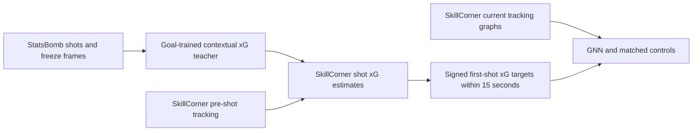
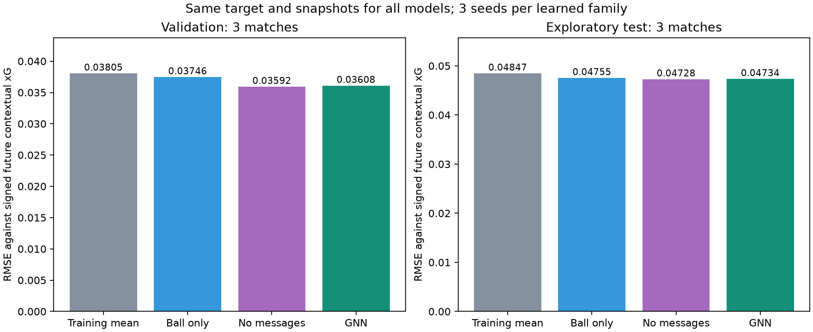

# Historical contextual net-value project

This documents the earlier single signed output. The main README now describes separate home and away values.

# Open Graph EPV — contextual xG targets

Predict **expected signed future contextual xG** from SkillCorner tracking.
A separate xG teacher learns from StatsBomb shot locations, goalkeeper positions,
defender positions and actual goal outcomes. Its estimates become the targets
for a graph neural network on SkillCorner situations before the shot.

This is a standalone research project with plain PyTorch and NumPy. It does not
import the parent football-RL project. **The primary EPV models are now trained
on contextual xG targets**, with explicit geometry fallback when shot context
cannot be trusted. No official StatsBomb xG values are copied or matched across
unrelated games.



Read the [contextual EPV experiment](../reports/contextual_epv.md) for the results,
all seeds, target-source diagnostics and the updated SkillCorner comparison.
The [xG teacher report](../reports/contextual_xg.md) explains the features, training
and transfer checks. The reports are in Norwegian; code and commands are in
English.

## Target and data

At time t, the target is the xG of the **first** shot in (t, t + 15 seconds]:
positive for the current possession team, negative for the opponent, zero when
there is no shot. The complete horizon must fall within the same period.
Elapsed time includes interruptions; it is not a same-possession return.
MSE trains the model toward the conditional mean of this target.

Future shot context is used to construct labels only. EPV input consists of
current tracking and backward velocity estimates, without future shot features.
The result is a signed expected first-shot value, not directly the probability
of at least one goal or a validated causal value for a proposed movement.

| Source / artifact | Coverage |
|---|---|
| StatsBomb original shot corpus | 644 matches; 16,509 shots |
| Contextual xG train / validation / test | 11,346 / 2,536 / 2,432 eligible shots |
| SkillCorner tracking | 20 Australian A-League 2024/25 matches |
| SkillCorner shot markers | 526: **413 contextual estimates, 113 geometry fallbacks** |
| EPV train / validation / test | 20,862 / 4,284 / 4,228 graphs from 14 / 3 / 3 matches |

The teacher is L2 logistic regression with 18 inputs: eight geometric terms,
five goalkeeper features and five defender features. Regularization and model
family are selected on StatsBomb validation matches. On the same 2,432 eligible
test shots, contextual log loss is **0.258118**, versus **0.275918** for a
geometry-only model trained on the same eligible population.

This gain is measured on StatsBomb. SkillCorner transfer calibration is not yet
validated. Almost all StatsBomb penalties lack eligible context, and penalty
identification in SkillCorner remains unresolved. Missing or unreliable shot
context uses the frozen geometry teacher; it never becomes a zero-valued shot
or a window with no shot. Consequently, the target is a **contextual/geometry
hybrid**, not complete contextual coverage of every shot.

The prepared data records the source of every target. Among 29,374 windows,
26,509 have no future shot, 2,350 use contextual xG and 515 use fallback xG.
Windows overlap and several can refer to the same shot.

## EPV experiment

The GNN contains two message-passing layers and 31,537 parameters. Each graph
contains the ball and up to 22 player slots, with masks for missing observations.
Inputs include positions, backward velocities, team relation, goalkeeper/ball
flags and observation validity. The possession team always attacks +x.
Extrapolated nodes are masked. Reflection augmentation and mirror averaging
make scores invariant to switching the two sides of the pitch.

Three seeds are trained for each of GNN, ball-only MLP, and the player model
without messages. All use the same new targets, snapshots and match split.
The no-message control retains the GNN's node networks and pooling while
zeroing message aggregation. The winning family is selected by validation MSE
of its three-seed ensemble. The GNN is always included in the inference bundle.

| Three-seed ensemble / reference | Validation RMSE | Test RMSE |
|---|---:|---:|
| Training-mean reference | 0.038045 | 0.048466 |
| Ball-only MLP | 0.037457 | 0.047546 |
| Players without messages | 0.035917 | 0.047279 |
| GNN | 0.036080 | 0.047335 |

The no-message player model won validation selection. Its test RMSE is also
slightly lower than GNN; the difference is uncertain across three matches.
GNN reduces test RMSE by 2.33% relative to the training-mean reference.

See the [results table and uncertainty](../reports/contextual_epv.md#resultater),
[numerical report](../reports/contextual_epv_v1.json),
[metrics CSV](../reports/contextual_epv_metrics.csv), and
[registered protocol](../configs/contextual_epv_v1.json).



The three test matches were examined in earlier experiments. This is an
exploratory extension, with no test-based fitting or selection in this run,
not a new untouched test set. Whole-match uncertainty intervals are descriptive.
**RMSE cannot be directly compared with earlier geometry-target RMSE**, since
the labels have changed. The updated provider comparison uses the same new
labels for every model and validation-only target adaptation for SkillCorner.
It does not establish better prediction of actual goals than their product.

## Reproduce

Run from this directory in a Python environment:

```bash
python -m pip install -e '.[dev,plots]'
pytest -q
```

Obtain the pinned source data and train the geometry teacher needed for fallback:

```bash
graph-epv xg-download --out data/statsbomb/shots.csv
graph-epv xg-train --shots data/statsbomb/shots.csv --out outputs/xg_v1
graph-epv download --matches all --tracking
```

These downloads require several GB. Existing verified downloads are reused;
there is no need to copy or download them again in the current workspace.
StatsBomb is pinned to `4b73468fc5b0f1950f9f66fada70ad3a4f9327cb` and SkillCorner
to `4340d274572876239c154c90bc507a9b3250a656`. Download receipts and SHA256 checks
protect raw inputs. No raw data is included in the source archive.

Train and evaluate contextual xG, then estimate SkillCorner shot values:

```bash
python -m open_graph_epv.contextual_xg prepare --out outputs/contextual_xg_data_v1
python -m open_graph_epv.contextual_xg select --out outputs/contextual_xg_v1
python -m open_graph_epv.contextual_xg evaluate --out outputs/contextual_xg_audit_v1
python -m open_graph_epv.contextual_xg transfer --out outputs/skillcorner_contextual_xg_v1
```

Prepare the new EPV dataset, freeze a local protocol, and run all nine models:

```bash
contextual-epv prepare --out outputs/contextual_epv_graphs_v1
contextual-epv register --out outputs/contextual_epv_protocol.json
python examples/run_contextual_epv.py --protocol outputs/contextual_epv_protocol.json
python examples/run_contextual_provider.py
python examples/report_contextual_epv.py
```

The runner selects on validation, evaluates the frozen selection and exports a
portable bundle. Output paths must be new for preparation/training stages.
The published protocol records this workspace's optional identity check against
legacy snapshots; `register` creates a matching protocol for a fresh checkout.
You do not need to reproduce the legacy EPV experiments first.

## Score a tracking frame

The bundle is generated at `outputs/contextual_epv_v1/bundle`. It includes
three GNN checkpoints and, if different, the validation-winning ensemble,
together with teacher parameters, source files, reports and checksums.

```python
from open_graph_epv.contextual_epv import load_bundle

model = load_bundle("outputs/contextual_epv_v1/bundle", family="gnn")
result = model.score_frame(current_frame, previous_frame, match_metadata)
# result['value']: signed future xG, relative to the current possession team
# result['home_signed_value']: the value from the home team's perspective
# result['seed_std']: seed dispersion, not a calibrated confidence interval
```

Omit `family` to load the validation-selected family. To read a raw match frame:

```bash
python examples/score_contextual_epv.py --match 2010085 --frame 100 --family gnn
```

The new bundle uses its own schema and loader; the earlier geometry bundle
remains compatible with `open_graph_epv.bundle.load_bundle`.

## Research status and history

The [model diagnostics and visualizations](../reports/contextual_diagnostics.md)
inspect ball-location patterns, error concentration, player-position sensitivity
and motion inputs without retraining. Six interactive tracking sequences and a
three-page PDF can be generated locally:

```bash
python examples/visualize_contextual_epv.py --out outputs/contextual_diagnostics_next
```

Open `explorer.html` in the resulting directory. It runs offline, with model
selection, playback, a time slider and a fixed home-team perspective. Cases are
explicitly hindsight-selected. Position perturbations describe model response,
not causal player contributions or movement recommendations. One future shot's
eight overlapping windows account for 48.2% of GNN test squared error, making
shot-level diagnostics important alongside snapshot averages.

The complete pipeline, training, evaluation and local inference are implemented.
See [verification](../reports/verification.json). Further scientific validation
requires independent matches, verified shot coverage and outcomes, calibrated
transfer across providers, and evidence for counterfactual action evaluation
before using the values to recommend movements or train a football policy.

Earlier [geometry-target EPV documentation](../reports/legacy_geometry_project.md),
[GNN/transformer/history experiment](../reports/attention_history.md) and
[geometry-target provider comparison](../reports/provider_comparison.md) are retained
as historical experiments. Their scores refer to the old teacher.

## Attribution and publication

Tracking and dynamic events: **SkillCorner**, released through the SkillCorner
and PySport open-data initiative. The upstream repository includes an MIT
license and requests attribution. The downloader preserves upstream README
and LICENSE alongside the data. See [upstream license](https://github.com/SkillCorner/opendata/blob/4340d274572876239c154c90bc507a9b3250a656/LICENSE).

The project code is MIT-licensed; see [LICENSE](../LICENSE). This directory can
be copied into a separate GitHub repository without the
parent project. Publish source, tests, configurations and reproducible reports;
download data from its original source. Document any additional xG data/model
terms separately. The included GitHub Actions workflow runs offline tests.
No GitHub repository has been created or published by this setup.

Create a clean source archive for a standalone repository:

```bash
python examples/package_source.py --out outputs/open-graph-epv-source.zip
```

The archive includes source, tests, configurations, reports, examples, assets
and the GitHub Actions workflow. It excludes raw data, trained checkpoints,
local outputs, caches and generated package metadata. Extract it and upload
the contents of its `open-graph-epv` folder as the repository root. The workflow
assumes this standalone layout. Users reproduce the model artifacts with the
commands above; pretrained weights are not part of the source archive.

The xG training source is **StatsBomb Open Data**. Data and analyses derived
from it are subject to the separate [StatsBomb public-data agreement](https://github.com/hudl/open-data/blob/4b73468fc5b0f1950f9f66fada70ad3a4f9327cb/LICENSE.pdf),
including its noncommercial-use and attribution terms. The code's MIT license
does not relicense that data or override those terms. Download original data
from StatsBomb; do not commit raw events or extracted shot rows to this repo.


