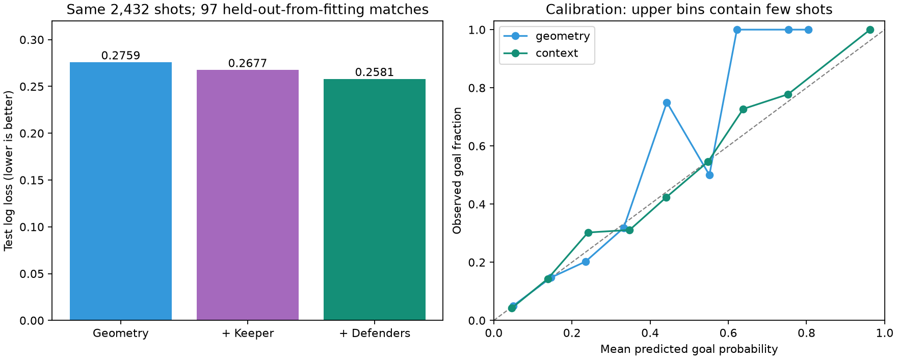

# Kontekstuell StatsBomb-xG og overføring til SkillCorner

**Oppdatering 6. november:** EPV er nå trent og evaluert med denne læreren. Se [det nye EPV-forsøket](contextual_epv.md). Rapporten nedenfor dokumenterer selve xG-forsøket fra 5. november.

Gjennomført 5. november 2026. **Keeper- og forsvarskontekst forbedrer prediksjonen på StatsBomb-testutvalget.** Modellen er trent mot faktiske mål/ikke-mål, med samme kampsplitt som den gamle geometrimodellen. Den nye kontekstmodellen ble valgt på valideringsdata før testevalueringen. Nye SkillCorner-verdier er eksportert separat; eksisterende EPV-modeller og targetfiler er uendret.

## Modell og data

Modellen er L2-regularisert logistisk regresjon med standardisering fra treningsdata. Vi sammenligner åtte geometriske features, disse pluss fem keeperfeatures, og til slutt fem forsvarsfeatures til: **18 features totalt**. Alle tre modellene trenes og sammenlignes på samme kontekstutvalg. Regularisering velges fra 0,1, 1, 10 og 100 etter validerings-log-loss; valgt styrke er henholdsvis 0,1, 10 og 100. Ingen vekter, egenskaper eller terskler er endret etter testresultatene.

Keeperfeatures er avstand til skytter, dybde fra mållinjen, vinkelrett avstand fra skytter–målsentrum-linjen, plassering innenfor skuddtrekanten og avstand til målsentrum. Forsvarsfeatures er nærmeste utespilleravstand, antall forsvarere innen tre meter, antall i skuddtrekanten, antall observerte utespillere og et kontinuerlig nærhetsmål: summen av exp(−avstand/3). Skuddtrekanten går fra skytteren til målstolpene. Dette er geometriske indikatorer, ikke en fysisk blokk-/redningsmodell.

Spillerposisjonene kommer fra `shot.freeze_frame` i StatsBombs hendelsesfiler, ikke fra en ny nedlasting av 360-data. StatsBombs egen [xG-beskrivelse](https://blogarchive.statsbomb.com/articles/soccer/upgrading-expected-goals/) forklarer hvorfor keeper-/forsvarsposisjon og usikkerhet i disse er relevante. Vår implementasjon er en egen, enklere modell og gjenskaper ikke deres proprietære xG.

StatsBomb-koordinater skaleres til en antatt bane på 105 × 68 meter. Modellen bruker ikke `statsbomb_xg`, skuddets sluttposisjon, utfall som input, ballbane etter skuddet, målhøyde, spilleridentitet eller EPV. Kroppsdel og straffetype er utelatt fra denne første overførbare modellen fordi vi ikke har en verifisert tilsvarende SkillCorner-annotasjon. Speiling gir identiske features.

| Del | Kamper | Alle skudd | Brukbar kontekst | Mål i kontekstutvalget |
|---|---:|---:|---:|---:|
| train | 450 | 11486 | 11346 | 1076 |
| val | 97 | 2560 | 2536 | 215 |
| test | 97 | 2463 | 2432 | 227 |

Totalt har 16 314 av 16 509 skudd brukbar kontekst. Vi krever én identifisert motstanderkeeper, minst én utespiller i forsvar, endelige koordinater og skuddposisjon foran mållinjen. Manglende kontekst erstattes ikke med kunstige spillerposisjoner. Råfilene og den eksisterende skuddtabellen verifiseres med SHA256.

## Den viktige straffeskjevheten

De 195 ekskluderte kontekstene inneholder **143 mål**. Av disse er 179 skudd straffer, hvorav 138 mål. Kun én av 180 straffer i korpuset har kvalifiserende kontekst. Kontekstmodellen har derfor nesten ingen støtte for straffesituasjoner. Fravær av keeper/forsvar skal ikke tolkes som «åpent mål».

| Skuddtype | Alle skudd | Brukbar kontekst | Mål uten brukbar kontekst |
|---|---:|---:|---:|
| Open Play | 15685 | 15669 | 5 |
| Free Kick | 639 | 639 | 0 |
| Penalty | 180 | 1 | 138 |
| Corner | 5 | 5 | 0 |

Denne skjevheten gjør en sammenligning på like utvalg nødvendig. Vi rapporterer også alle testskudd med en hybrid: valgt kontekstmodell når kontekst finnes, ellers den opprinnelige geometrimodellen. Det løser ikke modelleringen av straffer; det sikrer at de ikke forsvinner fra evalueringen. En fremtidig straffemodell trenger en separat, verifisert mapping og et nytt protokollfestet eksperiment.

## Resultater på samme 2 432 testskudd

Utvalget kommer fra 97 kamper som ikke ble brukt til fitting eller valg av regularisering. De samme kampene ble undersøkt i tidligere geometriforsøk, så dette er en utforskende utvidelse av den eksisterende testen, ikke et nytt urørt testsett.

| Modell | Log loss ↓ | Brier ↓ | AUC ↑ | ECE, 10 intervaller ↓ |
|---|---:|---:|---:|---:|
| geometry | 0.275918 | 0.077209 | 0.7360 | 0.0053 |
| keeper | 0.267681 | 0.075202 | 0.7609 | 0.0044 |
| context | 0.258118 | 0.072541 | 0.7871 | 0.0083 |
| frozen_geometry | 0.275798 | 0.077479 | 0.7385 | 0.0096 |

`geometry` er refittet på samme kontekstutvalg som de nye modellene. `frozen_geometry` er den gamle modellen trent på alle 11 486 treningsskudd. Keeper og forsvar gir **6.45 % lavere log loss** enn kontrollen med samme treningsutvalg.

Den primære log-loss-forskjellen er -0.017799, med beskrivende 95 % kamp-bootstrap-intervall [-0.027552, -0.008811]. Negativt favoriserer kontekstmodellen. Bootstrap bruker 2 000 parvise trekk av hele kamper, betinget på ferdigtrente modeller. Den inkluderer ikke ny trening eller usikkerhet ved overføring til en annen dataleverandør.



På **alle 2 463 testskudd**, inkludert manglende kontekst, er hybridens log loss **0.270392** mot **0.287849** for gammel geometri. Brier blir 0.077777 mot 0.082653, og AUC 0.8023 mot 0.7564.

Kalibreringen er ikke entydig bedre: på hele testutvalget er ECE 0.0155, mot 0.0056 før. ECE avhenger av intervallvalg og små høy-xG-grupper. Bedre log loss og Brier betyr bedre samlede sannsynlighetsprediksjoner på dette utvalget, men er ingen garanti for riktig sannsynlighet i alle situasjonstyper. Straffer og kildeoverføring er særlig uavklarte.

## Overføring til SkillCorner

StatsBombs skuddpunkt og SkillCorners hendelsespunkt brukes som geometrisk anker. SkillCorners hendelseskoordinater er allerede orientert mot angrepsretningen; bare trackingkoordinatene roteres. Keeper og utespillere må være observerte, ikke ekstrapolerte. Vi bruker eksakt `frame_end − 1` (omtrent 0,1 sekund før registrert skudd), et matchet besittelsesendepunkt, observerbar ball/skytter og maksimalt fire meter både mellom skytter og ball og mellom hendelsens skuddpunkt og den trackede skytteren. Dette er kvalitetskontroller, ikke en garanti for perfekt kontaktøyeblikk.

Av 526 skuddmarkører har **414** tilstrekkelig kontekst. **413** får ny modell; **113** beholder gammel geometri. Ett ellers kvalifiserende skudd hadde keeperdybde utenfor treningsutvalgets min/maks. Fallback skjer hvis en valgt input er utenfor treningsintervallet. Det beskytter mot noen ekstreme ekstrapolasjoner; å ligge innenfor min/maks er ikke bevis på korrekt kalibrering.

| Årsak til reserve-modell | Antall |
|---|---:|
| missing_or_ambiguous_keeper | 45 |
| shooter_ball_misalignment | 18 |
| unmatched_shot_endpoint | 31 |
| ball_not_observed | 5 |
| shooter_not_observed | 13 |
| outside_selected_training_feature_range | 1 |

Gjennomsnittlig estimert xG over alle 526 skudd endres fra **0.0891** til **0.0984**. Gjennomsnittlig absolutt endring er 0.0319. Det beskriver hvordan estimatene endres, ikke at sannsynlighetene er validert på SkillCorner.

Fordelingskontrollen viser blant annet større keeperavstand til målsentrum i SkillCorner-kontekstene enn i StatsBomb-treningen, omtrent 0,47 treningsstandardavvik. Vi dokumenterer alle 18 featurefordelingene. Ingen SkillCorner-målflagg brukes til å fitte eller velge xG-modellen.

Ingen av de 526 SkillCorner-skuddradene har `game_interruption_before=penalty_for`. Dette beviser ikke at datagrunnlaget er uten straffer, eller at alle straffer og skudd er korrekt registrert. Skudddekning, straffeidentifikasjon og skuddenes faktisk mål/ikke-mål må derfor fortsatt kontrolleres før påstander om målkalibrering eller taktisk forståelse.

## Bruk og reproduksjon

Fra `projects/open-graph-epv`, med pakken installert eller `PYTHONPATH=src`:

```sh
python -m open_graph_epv.contextual_xg prepare --out outputs/contextual_xg_data_v1
python -m open_graph_epv.contextual_xg select --out outputs/contextual_xg_v1
python -m open_graph_epv.contextual_xg evaluate --out outputs/contextual_xg_audit_v1
python -m open_graph_epv.contextual_xg transfer --out outputs/skillcorner_contextual_xg_v1
python examples/report_contextual_xg.py
```

Kjøringene krever de allerede nedlastede dataene og den frosne `outputs/xg_v1`-modellen fra hoved-README. Bruk nye utdatamapper ved gjentakelse; eksisterende resultater overskrives ikke. Ingen nye store datasett eller biblioteker er lastet ned.

Modellene ligger i `outputs/contextual_xg_v1/models.json`, med låst valg i `selection.json`. Nye eksperimentelle SkillCorner-targets ligger i **`outputs/skillcorner_contextual_xg_v1/shot_xg.csv`**, med begrunnelse og modellkilde per skudd i `shot_audit.json`. CSV-formatet kan leses av eksisterende EPV-pipeline; ingen skudd er fjernet eller satt til null på grunn av manglende kontekst.

Neste EPV-forsøk bør bruke en separat datasettversjon og denne hybridlæreren. Det må evalueres på samme nye target som sine referanser; lavere/høyere EPV-RMSE på en endret target kan ikke sammenlignes direkte med gamle RMSE-tall. Denne kjøringen har ferdigstilt xG-forsøket og overføringskontrollen, ikke trent EPV på nytt eller etablert SkillCorner-kalibrering.

De **46 offline-testene** omfatter lik fysisk scene hos begge leverandører, riktig koordinatrotasjon, speiling og spillerpermutasjon, uavhengighet av mål-/provider-xG-felter, manglende keeper/ball, tidsforskyvning og ujusterte skuddposisjoner. Eksisterende modeller beholdes som referanser.

Se [numerisk rapport](contextual_xg_v1.json), [CSV med metrikker](contextual_xg_metrics.csv) og [PDF-figur](figures/contextual_xg.pdf). Data kommer fra [StatsBomb Open Data](https://github.com/hudl/open-data) og [SkillCorner Open Data](https://github.com/SkillCorner/opendata); eksisterende attribusjon og separate datavilkår i README gjelder fortsatt. Ingen ekstern publisering er utført.
