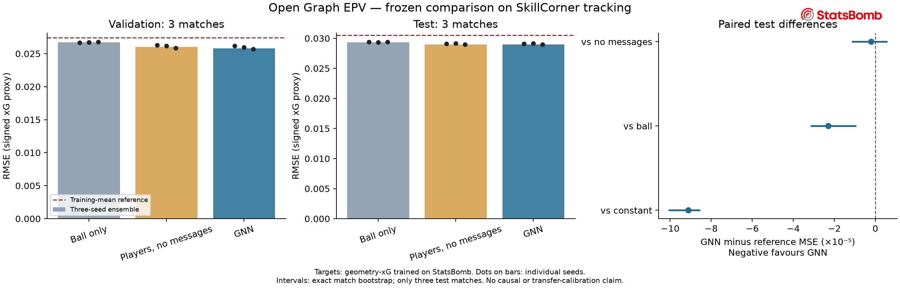

# Archived geometry-target project documentation

Historical setup retained for reproducing earlier experiments. See the main README for the contextual-target EPV project.

# Open Graph EPV

A standalone research starter for **graph-based expected signed future xG**
using [SkillCorner Open Data](https://github.com/SkillCorner/opendata).
It does not import the parent football-RL project or its private data/models.

**New: [StatsBomb contextual xG and SkillCorner transfer](../reports/contextual_xg.md).**
A new goal-trained teacher adds goalkeeper and defender positions from existing
shot freeze frames. On the same 2,432 context-eligible test shots, log loss falls
from 0.275918 to 0.258118 (6.45%). The hybrid covers all 526 SkillCorner shot
markers: 413 contextual estimates and 113 original-geometry fallbacks. Almost
all StatsBomb penalties lack eligible context; transfer calibration and penalty
coverage remain unresolved. New labels are separate experimental artifacts;
the EPV results below still use the original frozen geometry teacher.

**New: [controlled GNN/transformer/history experiment](../reports/attention_history.md).**
Nine small transformers were trained with the same xG targets and match split.
The snapshot transformer narrowly won validation selection; on the same 4,228
test snapshots, GNN RMSE was 0.028966, snapshot transformer 0.029054, and
trajectory-history transformer 0.029021. Genuine history slightly beats a
repeated-current-frame control, but no clear improvement over GNN is established.
GNN and transformer have 31,537 and 31,961 parameters. These are exploratory
results on previously examined test matches, not a new independent final test.

**New: [same-state comparison with SkillCorner EPV](../reports/provider_comparison.md).**
On 1,850 event-start states from three held-out matches, frozen GNN RMSE is
0.027602 versus 0.027556 for SkillCorner outputs adapted to our 15-second
future-xG target using validation matches only. Adapting both gives GNN
0.027533. Differences are small and uncertain; this does not demonstrate
superiority over SkillCorner's native goal-probability model. The existing
StatsBomb-trained xG teacher and GNN weights are reused without retraining.

**Status: xG transfer and a frozen, three-seed EPV comparison are complete.**
The GNN improves over ball-only and constant references on three held-out
matches. Its incremental advantage over a player model without messages is
small and uncertain. This is a reproducible research baseline, not validated
tactical advice. See the [final audit](../reports/epv_audit_v1.json) and
[validation selection](../reports/epv_selection_v1.json). The earlier
[single-seed experiment](../reports/experiment_v1.json) is retained as history.
The pinned upstream catalogue contains 20 Australian A-League 2024/25 matches,
although its README still says 10. Tracking is sampled at 10 Hz. The dynamic
events contain possession-ending shot markers, but **no shot-xG column**.
`xshot_*`, `xthreat`, and `possession_epv_*` are not substituted for xG.
The [source audit](../reports/source_audit.json) checks all 20 event files and
finds **526 shot markers**. No raw match data is committed here.
The initial real-data smoke check on match 1886347 produced 1,496 eligible snapshots
with an average of 16.09 visible nodes. The network forward pass was finite;
its weights were random. Forty-six offline tests now pass, including label alignment,
match separation, permutation/mirror invariance and LFS integrity checks.
The package also builds as a wheel. See [verification](../reports/verification.json).

## Target

At a snapshot with known possession, predict the xG of the first shot in
the next 15 seconds: positive for the team currently in possession, negative
for the opponent, zero when no shot occurs. Exclude the current instant and
require the full horizon within the same period. Horizons use elapsed frame
time, including interruptions; this is not a same-possession return.

Targets currently require an explicit, complete, aligned shot-xG CSV:

```text
match_id,event_id,period,frame,team_id,xg,xg_source
```

`frame` must equal the possession-ending shot marker's `frame_end`.
Missing xG raises an error; it is never converted to zero or inferred from
goal outcomes. Export a blank template with `shot-template` below.
The original frozen external xG model is trained on **actual goals/non-goals** in
StatsBomb Open Data. It uses eight position-derived geometric terms in an L2
logistic regression; provider xG is never used. The four regularization
candidates are selected on validation log loss, then the model is frozen.
All 526 SkillCorner shot markers now have estimated xG labels. They are
**model estimates, not SkillCorner-provided or independently observed xG**.
Shot-marker completeness and timing still need validation against an
independent event source.

StatsBomb's 120 x 80 coordinates are approximated on a 105 x 68 metre pitch.
SkillCorner dynamic-event positions are already attack-normalized, in actual
pitch metres: goal distance is `pitch_length / 2 - x_end`. Applying the
tracking-direction rotation again would be wrong. A 7.32 m goal is assumed.
In this original geometry baseline, no header, penalty-type, goalkeeper or
pressure features are shared. The separate contextual teacher described above
adds shared goalkeeper and defender positions. In-game
penalties are included but not distinguished from other shots at that location;
shoot-outs are excluded. Body-part/context mix and positional measurement
differences can affect transfer calibration.

## xG evaluation

The fixed corpus has **644 matches / 16,509 shots**: Premier League 2015/16,
the available Bundesliga 2023/24 matches, World Cups 2018/2022 and Euros
2020/2024. Two out-of-pitch shot locations are excluded and logged. Whole-match
splits contain 450 training, 97 validation and 97 test matches, seeded before
fitting. Only 11,486 training shots fit the coefficients; the held-out test
contains 2,463 shots. No SkillCorner outcomes enter fitting or selection.

| StatsBomb test metric | Geometry xG | Training-rate reference |
|---|---:|---:|
| Log loss | 0.28785 | 0.33014 |
| Brier score | 0.08265 | 0.09185 |
| AUC | 0.75643 | 0.50000 |

The paired whole-match bootstrap 95% interval for log-loss difference is
[-0.05209, -0.03262]. ECE with ten equal-width bins is 0.00560; its bin choice
and low sample counts at high predicted xG limit interpretation. These are
StatsBomb results, **not an A-League transfer validation**. SkillCorner shot
estimates range from 0.00075 to 0.39132 (mean 0.08913).

## Frozen EPV evaluation

The 20 SkillCorner tracking files produce **29,374 labelled graphs** after
observability and complete-horizon filtering: 20,862 training, 4,284 validation
and 4,228 test graphs from 14/3/3 chronological matches. Overlapping snapshots
are not independent observations.

Three seeds (0, 1, 2) were trained for each family under the fixed
[evaluation protocol](../configs/epv_evaluation_v1.json). The no-message control
uses the same players, encoder, node-update networks and pooling as the GNN,
but the aggregate message is zero. Its message parameters remain initialized
but unused. It is a control for message passing, not just a ball model.

| Equal-weight three-seed ensemble | Validation RMSE | Test RMSE |
|---|---:|---:|
| Training-mean reference | 0.02743 | 0.03050 |
| Ball-only MLP | 0.02671 | 0.02936 |
| Players without messages | 0.02601 | 0.02900 |
| GNN | **0.02581** | **0.02897** |

The GNN was selected by validation ensemble MSE. Checkpoint, dataset, report
and inference-source checksums were frozen **before** test predictions. On
test it improves RMSE by **5.03%** over the constant reference and **1.34%**
over the ball-only ensemble. All three GNN seeds individually beat the
constant reference. The improvement over the no-message ensemble is only
**0.13%**, with that control better on two of the three individual matches.

| Paired test MSE difference (GNN minus reference) | Difference | Descriptive 95% interval |
|---|---:|---:|
| Constant | -9.12e-5 | [-1.00e-4, -8.57e-5] |
| Ball only | -2.30e-5 | [-3.11e-5, -9.73e-6] |
| No messages | -2.12e-6 | [-1.11e-5, 5.41e-6] |

Intervals enumerate the 27 ordered whole-match bootstrap resamples and use
inverse empirical-CDF percentiles. **Three test matches are too few for strong
population claims**; the intervals do not include uncertainty in transferred
xG labels. The data supports player context more clearly than a distinct
benefit from message passing. No movement-ranking acceptance threshold is used.



[Download the standalone PDF figure](../reports/figures/epv_evaluation.pdf).

The test set is now consumed. Further tuning must not describe these same
three matches as an untouched final test. Broader transfer claims require
additional independent data.

## Model and input

- One graph per snapshot: ball plus up to 22 player slots with masks.
- Positions, backward one-frame velocities, team relation, keeper/ball flags,
  detection and velocity-valid flags. No player identity or outcome features.
- Centre-origin coordinates scaled by the actual pitch dimensions; the team
  in possession attacks +x. Missing/extrapolated nodes are masked by default.
- Two message-passing layers with relative position/distance and team edges;
  separate team/ball pooling; bounded signed value output; MSE loss.
- Reflection augmentation during training and mirror averaging at inference.
- This initial model uses **snapshots**, not a temporal GNN. Motion comes only
  from the preceding raw frame; gaps and period boundaries invalidate velocity.
- Plain PyTorch; no PyTorch Geometric installation is required.

## Run

From this directory, create a Python environment and install:

```bash
python -m pip install -e '.[dev,plots]'
graph-epv download --matches 1886347 --tracking
graph-epv audit --matches 1886347 --out outputs/data_audit.json
graph-epv inspect --matches 1886347
graph-epv shot-template --matches 1886347 --out shot_xg_template.csv
pytest -q
```

`inspect` checks real-data graph construction and a randomly initialized
network forward pass. It does **not** report predictive performance.
Downloads are pinned to upstream commit
`4340d274572876239c154c90bc507a9b3250a656`. Git LFS objects are resolved and
checked against their SHA256/size. Existing modified files are rejected.
Keep downloads and outputs outside version control.

Reproduce the public xG source and transfer:

```bash
graph-epv xg-download --out data/statsbomb/shots.csv
graph-epv xg-train --shots data/statsbomb/shots.csv --out outputs/xg_v1
graph-epv download --matches all --tracking
graph-epv xg-label --matches all --model outputs/xg_v1 --out outputs/skillcorner_xg_v1.csv
```

StatsBomb downloads are pinned to commit
`4b73468fc5b0f1950f9f66fada70ad3a4f9327cb`. Each raw file has a checksum
receipt. Expect several GB of downloads for both sources. Raw events, labels,
checkpoints and graphs remain ignored by Git.

Build graphs and reproduce all nine runs on fresh output paths:

```bash
graph-epv prepare --matches all --xg-csv outputs/skillcorner_xg_v1.csv --out outputs/graphs_v1
for family in gnn ball set; do
  for seed in 0 1 2; do
    graph-epv train --data outputs/graphs_v1 --split configs/split.json --out "outputs/${family}_seed${seed}" --seed "$seed" --model-kind "$family"
  done
done
graph-epv select --data outputs/graphs_v1 --runs outputs --protocol configs/epv_evaluation_v1.json --out outputs/selection_v1.json
graph-epv evaluate --data outputs/graphs_v1 --runs outputs --selection outputs/selection_v1.json --out outputs/audit_v1
graph-epv export --data outputs/graphs_v1 --runs outputs --selection outputs/selection_v1.json --audit outputs/audit_v1/report.json --xg-model outputs/xg_v1 --out outputs/bundle_v1
graph-epv plot-report --selection outputs/selection_v1.json --audit outputs/audit_v1/report.json --out outputs/figures
```

Outputs must be new paths. The chronological split has 14 training,
3 validation and 3 test matches. Training selects epochs using validation
MSE and does not evaluate test predictions. It records a training-mean
baseline. This is an initial experiment split, not enough independent test
matches for a strong generalization claim. `select` evaluates validation only;
`evaluate` rejects changed checkpoints, reports, data or inference code after
selection. The source tree and runtime versions are recorded for reproduction.

Load a local checkpoint with checksum verification:

```python
import torch
from open_graph_epv.training import load_epv

model = load_epv("outputs/gnn_seed0")
# nodes: float tensor [batch, 23, 10], mask: bool tensor [batch, 23]
with torch.no_grad():
    signed_future_xg = model.symmetric(nodes, mask)
```

The portable bundle contains the three GNN checkpoints, xG model, audit,
dataset manifest and a snapshot of the package source. It can score a raw
SkillCorner frame without loading the training dataset:

```python
from open_graph_epv.bundle import load_bundle

model = load_bundle("outputs/bundle_v1")
result = model.score_frame(current_frame, previous_frame, match_metadata)
# result['value']: signed xG relative to the current possession team
# result['home_signed_value']: the same quantity from the home-team perspective
# result['seed_std']: seed dispersion, NOT a calibrated confidence interval
```

An executable example reads the two raw frames and match metadata for you:

```bash
python examples/score_match.py --bundle outputs/bundle_v1 --match 2010085 --frame 100
```

## Remaining research

1. Independently verify SkillCorner shot coverage and xG transfer calibration.
2. Collect more independent matches for broader generalization evaluation.
3. Extend the completed temporal-history experiment to independent matches;
   a separate symmetry ablation remains open. Current results do not establish
   superiority of graph message passing or attention.
4. Establish intervention/transfer evidence before using counterfactual scores
   to recommend movements or train a football policy.
5. Test extrapolation sensitivity separately. Masking extrapolated positions
   does not establish that all upstream tracking/possession processing is causal.

The first-shot xG target defines a predictive value, not a causal estimate of
what would happen if a player moved. This project does not yet validate
tactical recommendations or RL rewards.

## Attribution and publication

Tracking and dynamic events: **SkillCorner**, released through the SkillCorner
and PySport open-data initiative. The upstream repository includes an MIT
license and requests attribution. The downloader preserves upstream README
and LICENSE alongside the data. See [upstream license](https://github.com/SkillCorner/opendata/blob/4340d274572876239c154c90bc507a9b3250a656/LICENSE).

The project code is MIT-licensed; see [LICENSE](../LICENSE). This directory can
be copied into a separate GitHub repository without the
parent project. Publish source, tests, configurations and reproducible reports;
download data from its original source. Document any additional xG data/model
terms separately. The included GitHub Actions workflow runs offline tests.
No GitHub repository has been created or published by this setup.

Create a clean source archive for a standalone repository:

```bash
python examples/package_source.py --out outputs/open-graph-epv-source.zip
```

The archive includes source, tests, configurations, reports, examples, assets
and the GitHub Actions workflow. It excludes raw data, trained checkpoints,
local outputs, caches and generated package metadata. Extract it and upload
the contents of its `open-graph-epv` folder as the repository root. The workflow
assumes this standalone layout. Users reproduce the model artifacts with the
commands above; pretrained weights are not part of the source archive.

The xG training source is **StatsBomb Open Data**. Data and analyses derived
from it are subject to the separate [StatsBomb public-data agreement](https://github.com/hudl/open-data/blob/4b73468fc5b0f1950f9f66fada70ad3a4f9327cb/LICENSE.pdf),
including its noncommercial-use and attribution terms. The code's MIT license
does not relicense that data or override those terms. Download original data
from StatsBomb; do not commit raw events or extracted shot rows to this repo.


