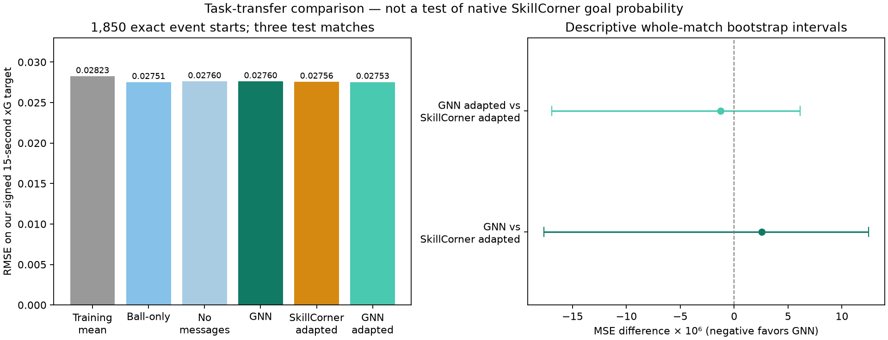

# GNN EPV versus SkillCorner: same-state comparison

**5 November 2026. The existing StatsBomb-trained xG → SkillCorner GNN pipeline is operational. The new comparison does not establish that our EPV is better than SkillCorner's.** Once SkillCorner's outputs are adapted to our target on validation matches, the models perform almost identically on three test matches.

## Model and target

The xG teacher is our eight-feature geometric logistic regression trained on **11,486 shots from 450 StatsBomb matches**, selected on separate validation matches. These are estimates from our goal-trained model, not StatsBomb's proprietary shot-xG values. No SkillCorner outcomes train this teacher. Its estimates cover all **526 SkillCorner shot markers**.

The EPV model is the existing two-layer message-passing GNN, ensembled over seeds 0, 1 and 2 with mirror averaging. Each model trained on **20,862 tracking snapshots from 14 SkillCorner matches**, using MSE and validation-based epoch selection. The ball-only and no-message controls are retained. All frozen weights are reused; this comparison does not retrain them or select a new family on test performance.

At time t, the target is the first shot's estimated xG in **(t, t + 15 seconds]**, positive for the current possession team and negative for the opponent. It is zero if no shot occurs. The complete horizon must fit within the same period. Interruptions do not terminate this horizon. This predicts signed future first-shot xG, not the probability of any goal over an arbitrary possession.

## Alignment with SkillCorner

The [SkillCorner open-data documentation](https://github.com/SkillCorner/opendata) identifies separate start/end values for scoring and conceding. We use `possession_epv_for_start` and `possession_epv_against_start`, paired with our prediction at **exactly `frame_start`**. Their raw signed state value is `for − against`. `possession_epv_total` is an action-level quantity and is not used as the state prediction.

Only player-possession rows with both numeric provider values, matched start timing, known tracking possession agreeing with the event team, and eligible observed-player graphs are included. Duplicate candidate events at the same period/frame are excluded. No nearest-frame interpolation, endpoint values, missing-value imputation or provider values enter the GNN's inputs. The current and immediately previous tracking frames construct positions and backward velocities.

There are **1,891 paired validation states** and **1,850 paired test states**. Test matches 2015213, 2016236 and 2017461 contribute 651, 657 and 542 states respectively. Of the 1,850 test targets, **172 are nonzero**. Missing provider values and visibility/timing filters mean this population differs from the original evenly sampled 4,228-state test evaluation. The new RMSE numbers must not be compared directly with that earlier report as a model improvement.

SkillCorner's [August 2026 product description](https://landing.skillcorner.com/articles/introducing-skillcorners-expected-possession-value-epv) refers to scoring within 30 seconds or before the next interruption. We have not independently confirmed which model version/horizon generated the open CSV values. Its goal-based description differs from our 15-second first-shot-xG target. Provider training overlap with these public matches is also unknown. Consequently, the raw-value result is a scale/target diagnostic, not a fair native-product accuracy ranking.

## Validation-only adaptation

Before computing the new test comparison, the fixed [protocol](../configs/provider_comparison_v1.json) specified ordinary least-squares adaptation on the three existing validation matches: 2010085, 2011166 and 2013725. No test target is used to fit these transformations.

The main SkillCorner baseline uses both components:

```text
adapted value = -0.00626838 + 0.34824757 × for - 0.04737925 × against
```

A net-only control uses `-0.00049539 + 0.29681641 × (for − against)`. We also apply an affine transformation to our GNN for symmetry of the comparison: `0.00105858 + 0.97694559 × GNN`. These are task-specific regressions, not recalibrated probabilities for SkillCorner's native objective. No clipping, test-based selection, or additional feature tuning was performed. Validation performance of these transformations is in-sample and is not reported as generalization performance.

## Results on the same 1,850 states

| Prediction | RMSE ↓ |
|---|---:|
| Original training-mean reference | 0.028233 |
| Ball-only ensemble | 0.027510 |
| Player ensemble without messages | 0.027604 |
| **GNN, frozen** | **0.027602** |
| SkillCorner raw for − against, different target | 0.033646 |
| **SkillCorner adapted, both components** | **0.027556** |
| SkillCorner adapted, net only | 0.027576 |
| **GNN adapted** | **0.027533** |

The registered main comparison favors adapted SkillCorner by about **0.17% RMSE**. The secondary comparison, adapting both predictors, favors our GNN by about **0.08% RMSE**. Such small changes in ordering do not demonstrate superiority. The ball-only model also marginally outperforms the GNN on this event-start subset.

The primary paired MSE difference, GNN minus adapted SkillCorner, is **+2.57 × 10⁻⁶**, with descriptive interval **[−1.77 × 10⁻⁵, +1.25 × 10⁻⁵]**. When both are adapted, the difference is **−1.24 × 10⁻⁶**, interval **[−1.69 × 10⁻⁵, +6.12 × 10⁻⁶]**. Both include zero. GNN is worse on two matches and better on one in both comparisons.

Intervals enumerate all 27 ordered whole-match bootstrap resamples. Overlapping within-match observations are not independent replicates. Three matches cannot support strong population claims; the intervals condition on fitted models and omit uncertainty in xG transfer, model refitting and upstream annotations. These matches were already used in earlier evaluation, so this is an **exploratory extension**, not a new untouched final test.



The raw GNN and SkillCorner net predictions have Pearson correlation **0.786**. Agreement indicates shared state information; it is not evidence that either predicts actual goals accurately.

## Reproduce without downloading or retraining

Run from `projects/open-graph-epv` with the installed package or `PYTHONPATH=src`:

```sh
python -m open_graph_epv.provider_comparison prepare --out outputs/provider_pairs_v1
python -m open_graph_epv.provider_comparison calibrate --pairs outputs/provider_pairs_v1 --out outputs/provider_calibration_v1.json
python -m open_graph_epv.provider_comparison evaluate --pairs outputs/provider_pairs_v1 --calibration outputs/provider_calibration_v1.json --out outputs/provider_audit_v1
python examples/report_provider_comparison.py
```

Use fresh output names for another run; existing artifacts are protected against overwrite. A new checkout must first reproduce/download the existing teacher and EPV artifacts using the commands in the main README. The pairing stage streams the existing raw files and writes only compact matched graphs; it does not copy the large tracking corpus.

`outputs/provider_pairs_v1/manifest.json` records every match's exclusion counts, input hashes, target provenance and source checksums. Calibration coefficients and frozen model identities are in `outputs/provider_calibration_v1.json`. Per-state predictions and targets remain in `outputs/provider_audit_v1/predictions.csv`. The shareable [numerical report](provider_comparison_v1.json), [metrics CSV](provider_comparison_metrics.csv) and [PDF figure](figures/provider_comparison.pdf) accompany this page.

The test suite checks field semantics, missing-value abstention, exact event-start selection, duplicate removal, affine mapping and strict future-target boundaries, alongside the existing split, symmetry and provenance tests. **30 offline tests pass.**

## What this establishes

This is a working, reproducible GitHub research project: external xG teacher, tracking GNN, same-state provider comparison, controls and honest uncertainty. It establishes similar predictive performance on **our transferred-xG target**, not a better SkillCorner replacement or calibrated goal probability. The geometric teacher still lacks goalkeeper/defender context and remains unvalidated for A-League transfer.

The next scientific step is to verify provider model semantics and shot outcomes, then evaluate a common target on new independent matches. Richer xG and temporal EPV features can be tested under a new protocol. Repeatedly tuning against these three matches would not make a stronger superiority claim. No GitHub repository has been created or published by this work.
