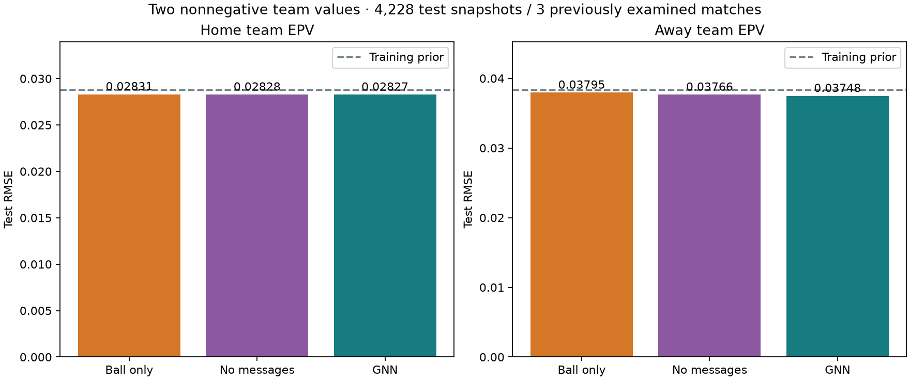

# To separate EPV-verdier: hjemme og borte

Ny hovedversjon, 10. november 2026. Modellen predikerer **`home_team_epv` og `away_team_epv` separat**. Begge er ikke-negative og kan være positive samtidig. De kommer fra en ny modell med to komponenter; vi klipper ikke den gamle nettoprediksjonen i en positiv og en negativ del.

## Målvariabler

Vi beholder horisonten (t, t + 15 sekunder] og **det første skuddet totalt** i samme omgang. Hjemmetarget er skuddets kontekstuelle xG dersom hjemmelaget tar dette skuddet, ellers null. Bortetarget defineres tilsvarende. Hvis det ikke kommer skudd, er begge null. Dette er ikke første skudd separat for hvert lag, og verdiene summerer ikke xG over flere skudd.

Modellen lærer E[Y_home | situasjon] og E[Y_away | situasjon]. Et bestemt observert vindu har maksimalt én positiv target, men før framtiden er kjent kan begge lagenes forventninger være positive. For eksempel kan 0,03 og 0,02 gi samme nettoverdi som 0,11 og 0,10, selv om situasjonene har ulik samlet forventet skuddverdi.

Netto hjemmeverdi kan fortsatt beregnes som `home_team_epv - away_team_epv`, men er nå en avledet størrelse. Verdiene er forventet første-skudd-xG, ikke direkte sannsynligheten for minst ett mål. Summen er heller ikke sannsynligheten for et skudd.

## Trening og lagidentitet

De samme 29 374 grafene brukes. Vi leser hjemme-/bortelag og faktisk ballbesittelse fra verifiserte råfiler. Nye lagtargets rekonstruerer nøyaktig den gamle signerte targeten som differanse, men treningen minimerer gjennomsnittlig MSE over **begge komponentene**. Ni modeller er trent fra ny initialisering: GNN, spillermodell uten meldinger og ballmodell, tre seeds hver. Samme kampsplitt, maks 30 epoker og tidlig stopp etter åtte epoker uten forbedring brukes.

Internt er input fortsatt orientert etter laget med ballen. Utgangene er forventning for besittelseslaget og motstanderen. API-et bytter kanalene ved behov for å returnere faktisk hjemme- og bortelag; verdiene negeres aldri. Hjemme-/borteidentiteten endres ikke ved besittelsesbytte eller pause.

Modellen har tre softmax-logitter, hvor de to første er lagverdiene og den tredje er restmasse. Dette sikrer ikke-negative verdier med sum høyst én. Restmassen skal ikke tolkes som sannsynligheten for ingen skudd. Bare de to EPV-komponentene inngår i MSE. Speilaugmentering og speilsnitt beholdes.

Læreren er uendret: 413 SkillCorner-skudd med kontekstuell xG og 113 geometriske reserveverdier. Ingen labels fjernes. De nye målfilene lagrer også lag-ID-er og om hjemmelaget hadde ballen, og gjenbruker grafdata uten å kopiere store trackingfiler.

## Resultater

Valideringsvinner: **set**, valgt etter to-komponent-MSE før testberegning. GNN finnes alltid i inferenspakken.

| Modell / tre seeds | Validerings-RMSE, begge | Test-RMSE, begge | Test-RMSE hjemme | Test-RMSE borte |
|---|---:|---:|---:|---:|
| ball | 0.026231 | 0.033477 | 0.028308 | 0.037949 |
| set | 0.025301 | 0.033305 | 0.028282 | 0.037664 |
| gnn | 0.025388 | 0.033200 | 0.028274 | 0.037484 |

Konstant referanse basert på treningens forventninger for besittelseslag/motstander har samlet test-RMSE **0.033899**. Den mappes til hjemme/borte etter hvem som har ballen. Komponent-RMSE kan ikke sammenlignes direkte med tidligere netto-RMSE, fordi tapsfunksjonen og dimensjonen er forskjellige.



Som sekundær kontroll gir differansen mellom GNN-ens nye lagverdier netto-RMSE 0.047112, mot 0.047335 for gammel GNN på identiske targets og situasjoner. Parvis netto-MSE-forskjell er -0.00002109, med beskrivende 95 % kampintervall [-0.00002822, -0.00001700]. Dette måler nettoverdien, ikke kvaliteten på de to komponentene hver for seg.

Dette er en utforskende evaluering på tre tidligere undersøkte testkamper. Det etablerer ikke bedre målkalibrering, taktisk forståelse eller overlegenhet over SkillCorner. Eldre SkillCorner-sammenligninger og følsomhetsdiagnostikk gjelder den gamle nettomodellen.

## API og visualisering

```python
from open_graph_epv.team_epv import load_bundle

model = load_bundle("outputs/team_epv_v1/bundle", family="gnn")
result = model.score_frame(current_frame, previous_frame, match_metadata)
home_team_epv = result["home_team_epv"]
away_team_epv = result["away_team_epv"]
```

Resultatet inkluderer faktiske `home_team_id` og `away_team_id`. `net_home_epv` er kun den avledede differansen. `seed_std` gir modellspredning for hver komponent, ikke kalibrerte konfidensintervaller. Utelat `family` for å laste valideringsvinneren.

Åpne lokalt `outputs/team_epv_visualizations_v1/explorer.html` i nettleseren. Den nye sekvensviseren har to samtidige verdikort og to kurver, én for hvert lag, med faste lagfarger og fast hjemmelagsorientert bane. Modellbytte, avspilling, tidsskyver og begge realiserte targetkurvene er tilgjengelige. `outputs/team_epv_visualizations_v1/team_epv.pdf` inneholder resultat- og sekvensfigurer. Eksemplene er valgt med etterpåinformasjon og er ikke et representativt ytelsesutvalg.

Reproduser etter klargjøring av de kontekstuelle basisgrafene:

```bash
python -m open_graph_epv.team_epv prepare --out outputs/team_epv_data_v1
python examples/run_team_epv.py --legacy ""
python examples/report_team_epv.py
```

Bruk nye utdatamapper hvis kjøringene finnes. `--legacy ""` gjør at en ny installasjon ikke trenger å trene den gamle nettomodellen; uten flagget kan dens eksisterende audit brukes til sekundærsammenligningen. Se [full numerisk rapport](team_epv_v1.json) og hoved-README for datanedlasting og xG-læreren. SkillCorner-/StatsBomb-attribusjon og separate datavilkår gjelder fortsatt.

## Verifisering

65 offline-tester passerer. Inferenspakken er kontrollert på 12 rå snapshots fra alle tre testkampene, med begge omganger og begge besittelseslag. Begge lagverdiene stemmer med den frosne evalueringen innen 2,8e-9. Nettleserkontrollen dekker 54 kombinasjoner av klipp, modell og tidspunkt, samt avspilling, klikk i tidslinjen og mobilvisning. Ingen JavaScript-feil ble funnet.
